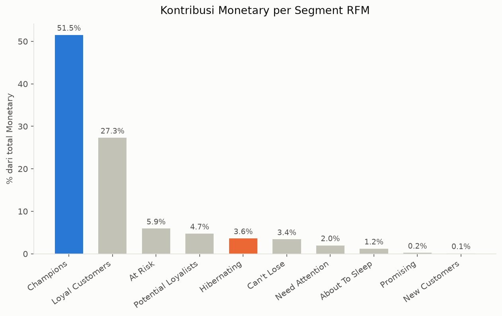
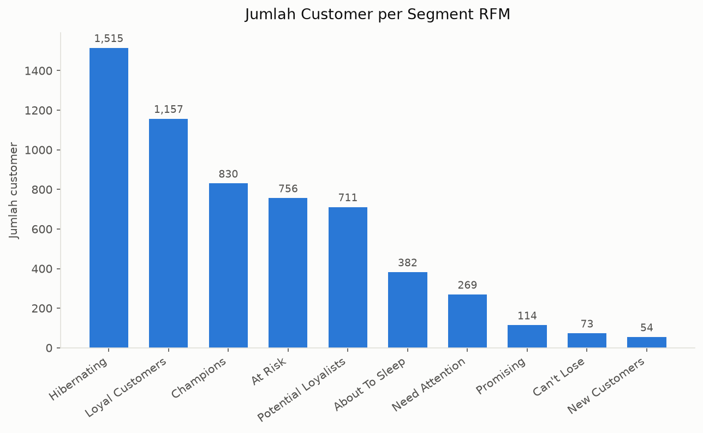
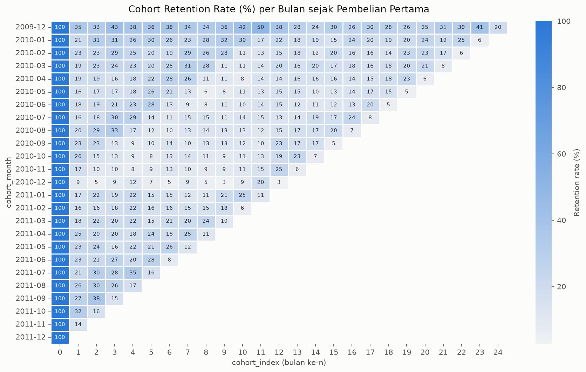
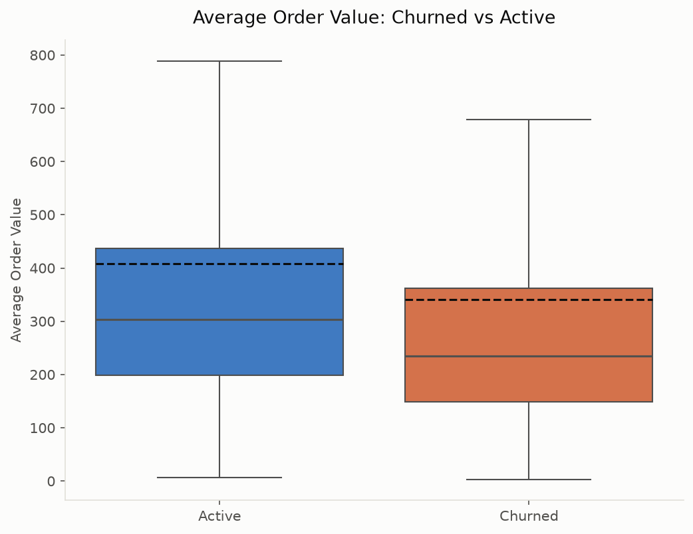
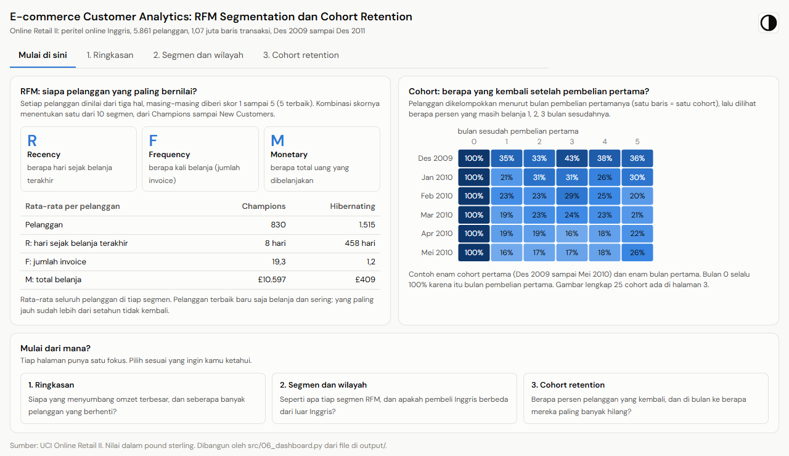
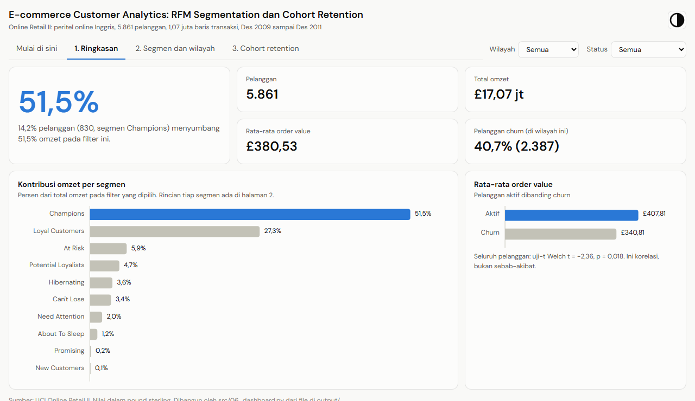
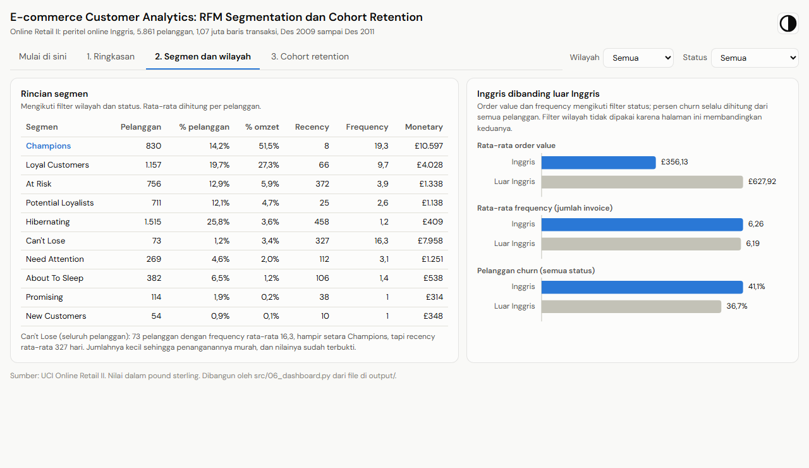
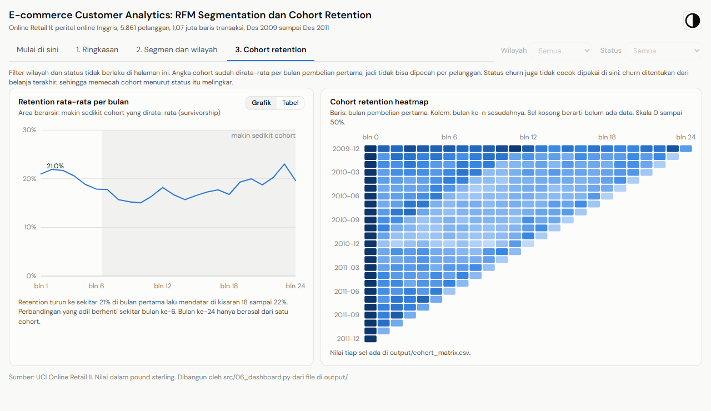

# RFM Segmentation & Cohort Analysis — Online Retail II

Analisis customer analytics di atas data transaksi ritel online Inggris,
Desember 2009 – Desember 2011: siapa pelanggan yang paling bernilai, berapa
banyak yang bertahan setelah pembelian pertama, dan apa yang membedakan
pelanggan yang berhenti dari yang masih aktif.

**Stack:** Python (pandas, matplotlib, seaborn, scipy) · SQL/SQLite · Jupyter

**Dashboard interaktif:** [buka di browser](https://samuel-geraldo.github.io/rfm-cohort-ecommerce/) (empat halaman, filter wilayah dan status churn).

---

## Latar Belakang

Sebagian besar bisnis ritel tahu berapa total revenue-nya, tapi tidak tahu
revenue itu datang dari siapa. Pertanyaan "berapa persen pelanggan yang
menyumbang separuh omzet" dan "berapa banyak pembeli pertama yang kembali
bulan depan" jarang bisa dijawab dari laporan penjualan biasa, padahal dua
angka itu yang menentukan apakah anggaran lebih baik dipakai untuk akuisisi
pelanggan baru atau untuk menahan yang sudah ada.

Project ini menjawab keduanya dengan dua teknik standar customer analytics —
segmentasi RFM dan cohort retention analysis — lalu mengujinya secara
statistik alih-alih berhenti di deskripsi.

Ini project portofolio kedua saya. Yang pertama menganalisis saham rantai
pasok pangan di Bursa Efek Indonesia (domain financial/market analytics).
Project ini sengaja mengambil domain yang berbeda.

---

## Dataset

[**Online Retail II**](https://archive.ics.uci.edu/dataset/502/online+retail+ii)
dari UCI Machine Learning Repository — transaksi riil sebuah peritel online
asal Inggris yang menjual perlengkapan hadiah, mayoritas ke pembeli grosir.

| | |
|---|---|
| Baris mentah | 1.067.371 |
| Baris setelah cleaning | 776.624 |
| Rentang | 1 Des 2009 – 9 Des 2011 |
| Invoice unik | 36.639 |
| Produk unik | 4.624 |
| Pelanggan unik | 5.861 |
| Negara | 41 (90,09% baris dari Inggris) |
| Snapshot date untuk Recency | 2011-12-10 |

File mentahnya tidak ikut di-commit (lihat [`.gitignore`](.gitignore) dan
[`data/raw/SUMBER_DATA.md`](data/raw/SUMBER_DATA.md)) — unduh sendiri dari
tautan di atas.

### Kenapa bukan Olist

Kandidat pertama saya adalah Olist Brazilian E-Commerce, dataset yang jauh
lebih populer di portofolio. Saya tolak setelah mengeceknya, karena dua hal.

Pertama, ada jebakan skema yang gampang terlewat: kolom `customer_id` di
tabel orders Olist **unik per order**, bukan per pelanggan. Pelanggan yang
sebenarnya ada di `customer_unique_id` di tabel terpisah. Kalau RFM dihitung
pakai `customer_id`, semua Frequency keluar 1 dan seluruh sel cohort
retention jadi 0% — dan tidak ada satu pun error yang muncul untuk memberi
tahu bahwa analisisnya salah.

Kedua, bahkan setelah memakai kolom yang benar, repeat purchase rate Olist
hanya sekitar 3%. Dengan angka serendah itu, cohort retention matrix-nya
nyaris kosong dan separuh analisis ini kehilangan isi. Sebagai pembanding,
Online Retail II punya 4.236 dari 5.861 pelanggan (72,3%) yang belanja lebih
dari sekali.

Pengecekan itu ada di [`src/00_cek_olist.py`](src/00_cek_olist.py) supaya
keputusannya bisa dibuktikan ulang, bukan cuma diklaim di sini.

---

## Pertanyaan Analisis

1. Bagaimana segmentasi pelanggan berdasarkan RFM (Recency, Frequency, Monetary)?
2. Segmen mana yang paling bernilai?
3. Bagaimana pola retention per cohort bulan pembelian pertama?
4. Apa yang membedakan pelanggan yang churn dari yang masih aktif?
5. Apakah pola belanja pembeli Inggris berbeda dari pembeli luar Inggris?

---

## Metodologi

### Cleaning

Urutannya dikunci sejak awal proyek dan tidak diubah. Tiap langkah yang membuang
baris mencatat berapa baris dan berapa persen revenue yang ikut hilang —
supaya jelas apa yang dibuang, bukan sekadar "data sudah dibersihkan".

| Langkah | Baris hilang | Revenue hilang |
|---|---|---|
| Buang `Customer ID` kosong | 22,77% | 13,68% |
| Buang invoice pembatalan (`C…`) | 2,27% | −6,58% |
| Buang `Quantity ≤ 0` dan `Price ≤ 0` | 0,01% | 0,00% |
| Buang StockCode non-produk (ongkir, diskon, biaya bank) | 0,36% | 1,72% |
| Buang baris duplikat persis | 3,25% | 2,10% |

Revenue **naik** saat baris pembatalan dibuang karena baris itu bernilai
negatif — persentase minus di tabel itu benar, bukan salah hitung.

Baris tanpa `Customer ID` dibuang meski jumlahnya besar: analisis ini
seluruhnya berbasis pelanggan, dan transaksi tanpa identitas pelanggan tidak
bisa dimasukkan ke segmen atau cohort mana pun.

### RFM Scoring

Recency (hari sejak transaksi terakhir), Frequency (jumlah invoice unik,
bukan jumlah baris item), dan Monetary (total revenue) dihitung per
pelanggan, lalu masing-masing diberi skor 1–5 berbasis quintile. Segment
dipetakan dari kombinasi skor R dan F.

### Cohort Analysis

Pelanggan dikelompokkan berdasarkan bulan transaksi pertamanya, lalu dihitung
berapa persen dari tiap cohort yang masih belanja di bulan ke-n sesudahnya.
Hasilnya matriks 25 × 25.

### Uji Statistik

Ambang churn awal 180 hari **tidak langsung dipakai**, tapi divalidasi dulu
dengan distribusi interval antar-order dari pelanggan repeat:

| Persentil interval antar-order | Hari |
|---|---|
| P25 | 7 |
| P50 | 25 |
| P75 | 62 |
| P90 | 135 |

Hanya 6,36% interval yang melebihi 180 hari, dan P90 ada di 135 hari — jauh
di bawah ambang. Artinya 180 hari cukup longgar untuk tidak salah menandai
pelanggan yang siklus belanjanya memang panjang sebagai churn. Ambang
dipertahankan.

Perbandingan average order value antara kelompok churn dan aktif diuji
dengan **uji-t Welch** (tidak mengasumsikan varians kedua kelompok sama,
karena ukuran dan sebarannya jelas berbeda).

---

## Temuan Utama

### 1. 14% pelanggan menyumbang lebih dari separuh omzet



**Champions** — 830 pelanggan, 14,16% dari total — menyumbang **51,52%**
dari seluruh revenue. Di ujung lain, **Hibernating** adalah segmen
*terbesar* (1.515 pelanggan, 25,85%) tapi hanya menyumbang 3,62%.

Pola 80/20 yang klasik, tapi implikasinya konkret: kehilangan satu Champion
setara dengan kehilangan sekitar 26 pelanggan Hibernating dari sisi revenue
(rata-rata Monetary 10.597 vs 408).



| Segment | Pelanggan | % pelanggan | % revenue | Rata² Frequency |
|---|---:|---:|---:|---:|
| Champions | 830 | 14,16% | 51,52% | 19,3 |
| Loyal Customers | 1.157 | 19,74% | 27,30% | 9,7 |
| At Risk | 756 | 12,90% | 5,92% | 3,9 |
| Potential Loyalists | 711 | 12,13% | 4,74% | 2,6 |
| Hibernating | 1.515 | 25,85% | 3,62% | 1,2 |
| Can't Lose | 73 | 1,25% | 3,40% | 16,3 |
| Need Attention | 269 | 4,59% | 1,97% | 3,1 |
| About To Sleep | 382 | 6,52% | 1,20% | 1,4 |
| Promising | 114 | 1,95% | 0,21% | 1,0 |
| New Customers | 54 | 0,92% | 0,11% | 1,0 |

Segmen yang paling layak ditindaklanjuti justru **Can't Lose**: hanya 73
pelanggan, tapi rata-rata Frequency-nya 16,3 — hampir setara Champions —
dengan Recency rata-rata 327 hari. Ini pelanggan yang dulu sangat aktif lalu
berhenti. Jumlahnya kecil sehingga penanganannya murah, dan nilainya sudah
terbukti.

### 2. Retention anjlok di bulan pertama, lalu mendatar



Dari 100% di bulan ke-0 (per definisi), retention turun ke rata-rata
**20,99%** di bulan ke-1. Yang menarik justru sesudahnya: alih-alih terus
meluruh, angkanya **stabil** di kisaran 18–22% sampai bulan ke-24.

| Bulan ke- | 1 | 2 | 3 | 4 | 5 | 6 | 12 | 24 |
|---|---:|---:|---:|---:|---:|---:|---:|---:|
| Retention rata-rata | 20,99% | 21,93% | 21,69% | 20,57% | 18,84% | 17,88% | 18,19% | 19,64% |
| Jumlah cohort yang dirata-rata | 24 | 23 | 22 | 21 | 20 | 19 | 13 | 1 |

Bacaannya: kerugian pelanggan hampir seluruhnya terjadi di satu bulan
pertama. Yang lolos dari bulan itu cenderung bertahan lama. Untuk bisnis ini,
intervensi retention paling berdampak kalau diarahkan ke jendela ~30 hari
setelah pembelian pertama, bukan disebar rata sepanjang tahun.

Satu catatan penting dalam membaca tabel itu: makin ke kanan, makin sedikit
cohort yang ikut dirata-rata. Kolom bulan ke-1 dirata-rata dari 24 cohort,
sedangkan kolom bulan ke-24 hanya berasal dari **satu** cohort (Desember
2009) — karena cuma cohort itu yang sudah berumur dua tahun saat data
berakhir. Jadi kestabilan di kolom-kolom paling kanan sebagian adalah efek
survivorship: yang tersisa di sana hanya cohort tua yang kebetulan kuat,
bukan bukti bahwa semua cohort bertahan sebaik itu. Perbandingan yang adil
berhenti di sekitar bulan ke-6, saat masih ada 19 cohort yang dirata-rata.

Cohort Desember 2009 adalah yang terbesar (952 pelanggan) sekaligus yang
paling kuat: rata-rata retention-nya 37,1% sepanjang enam bulan pertama,
dibanding 27,5% untuk cohort terbaik berikutnya.

### 3. Pelanggan aktif punya order value lebih tinggi — dan perbedaannya signifikan



Dengan ambang 180 hari: 2.387 pelanggan (40,73%) churn, 3.474 (59,27%) masih
aktif.

| | Churned | Active |
|---|---:|---:|
| Jumlah pelanggan | 2.387 | 3.474 |
| Rata-rata order value | 340,81 | 407,81 |

Uji-t Welch: **t = −2,3593, p = 0,0183**. Di α = 0,05, perbedaannya
signifikan secara statistik — bukan kebetulan sampel.

Perlu dicatat kehati-hatiannya: ini korelasi, bukan sebab-akibat. Data ini
tidak bisa membedakan apakah order kecil membuat orang berhenti, atau orang
yang memang berniat sekali beli cenderung memesan sedikit. Yang bisa
disimpulkan: **nilai order pertama layak dipakai sebagai sinyal peringatan
dini** untuk menandai pelanggan yang berisiko tidak kembali.

### 4. Pembeli luar Inggris memesan hampir dua kali lebih besar

| | Jumlah pelanggan | Rata-rata order value | Rata-rata frequency |
|---|---:|---:|---:|
| Inggris | 5.335 | 356,13 | 6,26 |
| Luar Inggris | 526 | **627,92** | 6,19 |

Frequency-nya hampir identik (6,19 vs 6,26), tapi order value-nya 76% lebih
tinggi. Jadi perbedaannya bukan "pelanggan ekspor lebih jarang belanja",
melainkan **sekali belanja jauh lebih besar** — konsisten dengan pola
pembelian grosir yang harus menanggung ongkos kirim lintas negara.

Dengan hanya 9% pelanggan tapi order value 1,76×, segmen luar Inggris punya
bobot yang tidak sebanding dengan jumlahnya.

Analisis geografis sengaja berhenti di level Inggris vs luar Inggris dan
tidak dipecah ke 41 negara: 90% baris berasal dari satu negara, sehingga
perbandingan per negara akan bersandar pada sampel yang terlalu kecil.

---

## Kendala & Debugging

Tiga bug nyata yang muncul selama pengerjaan, didokumentasikan lengkap
(gejala, penyebab, solusi) di [`docs/bugs.md`](docs/bugs.md). Ringkasnya:

**1. `to_parquet` gagal dengan `ArrowInvalid` di langkah terakhir.** Kolom
`Invoice` dan `StockCode` berisi campuran `int` dan `str` dalam satu kolom
`object` (`85123` di satu baris, `'79323P'` di baris lain). Pandas tidak
keberatan, tapi pyarrow menyimpulkan tipe kolom dari sampel lalu gagal saat
bertemu nilai yang tidak cocok. Solusinya cast eksplisit ke `str` — keduanya
memang identifier, bukan angka untuk dihitung.

**2. Pivot cohort menghasilkan MultiIndex kolom.** `pivot_table` tanpa
argumen `values` eksplisit memakai semua kolom numerik sisa sebagai value,
sehingga kolomnya selalu bertingkat dua level. Akibatnya `cohort_matrix[0]`
gagal karena nama kolom sebenarnya `('Customer ID', 0)`. Solusinya `.pivot()`
dengan `values` diisi eksplisit, plus `assert` supaya kalau regresi lagi
langsung ketahuan alih-alih salah baca kolom diam-diam.

**3. F_score berbeda ~24% antara SQL dan Python.** Validasi silang
`queries.sql` terhadap `02_rfm.py` menunjukkan Recency/Frequency/Monetary
cocok 100%, tapi F_score cuma cocok 76,22% (1.394 dari 5.861 pelanggan,
semuanya selisih tepat ±1). Penyebabnya Frequency sangat menumpuk di nilai
kecil — 1.625 pelanggan dengan Frequency = 1 saja sudah melebihi seperlima
populasi — sehingga baik `NTILE(5)` maupun `qcut(rank(method='first'))`
harus memotong paksa blok nilai identik, dengan urutan tie-break yang
berbeda. Ini **bukan salah hitung**: keduanya quintile yang sama-sama valid
untuk data dengan tie sebanyak ini, dan tidak ada satu urutan tie-break yang
"benar". Yang penting diverifikasi adalah selisihnya selalu ±1, bukan lebih.
`output/rfm_table.csv` dipakai sebagai sumber kebenaran untuk Segment.

---

## SQL

[`sql/queries.sql`](sql/queries.sql) menghitung ulang metrik utama langsung
dari tabel `transactions` di SQLite — bukan mengimpor CSV hasil Python —
sehingga berfungsi sebagai validasi silang yang independen.

| Query | Teknik |
|---|---|
| 1. Skor RFM per pelanggan | `NTILE(5) OVER (ORDER BY …)` |
| 2. Jarak hari antar-order | `LAG() OVER (PARTITION BY … ORDER BY …)` |
| 3. Rata-rata monetary per cohort | CTE bertingkat |
| 4. Interval dari order pertama | Self-join |

SQLite tidak punya tipe date native, jadi `InvoiceDate` disimpan sebagai TEXT
ISO dan diolah lewat `julianday()` untuk selisih tanggal dan `strftime()`
untuk grouping bulan.

---

## Dashboard

**[Buka dashboard interaktif](https://samuel-geraldo.github.io/rfm-cohort-ecommerce/dashboard/customer_analytics.html)** (satu halaman web, tidak perlu menginstal apa pun; filter wilayah dan status churn bisa dicoba langsung).

**Mulai di sini: apa itu RFM dan cohort**



**Halaman 1: Ringkasan**



**Halaman 2: Segmen dan wilayah**



**Halaman 3: Cohort retention**



Dua keluaran, keduanya dibangun dari file di `output/` tanpa data mentah:

- [`dashboard/customer_analytics.html`](dashboard/customer_analytics.html): dashboard
  interaktif satu file (buka langsung di browser), landscape. Halaman pembuka menjelaskan
  RFM dan cohort dengan data asli proyek ini, lalu tiga halaman analisis:
  ringkasan (kartu angka, kontribusi omzet per segmen, order value aktif dibanding
  churn), segmen dan wilayah (tabel rincian segmen, Inggris dibanding luar Inggris),
  dan cohort retention (retention per bulan dan heatmap). Filter wilayah dan status
  berlaku di halaman 1 dan 2. Dibangun oleh `src/06_dashboard.py`, yang
  berhenti kalau angkanya tidak cocok dengan hasil di atas (2.387 churn, 5.335
  pelanggan Inggris, retention bulan ke-1 20,99%).
- [`dashboard/powerbi/`](dashboard/powerbi/): paket impor Power BI (tiga tabel CSV,
  measure DAX, tema warna, dan panduan dengan angka acuan untuk memeriksa hasil).
  Dibangun oleh `src/07_powerbi_data.py`. Berkas `.pbix` belum dibuat; paket ini
  berisi bahan untuk menyusunnya sendiri di Power BI Desktop.

---

## Struktur Repo

```
rfm-cohort-ecommerce/
├── data/
│   ├── raw/                      # file mentah (tidak di-commit)
│   └── processed/                # retail_bersih.parquet
├── src/
│   ├── 00_cek_olist.py           # evaluasi dataset alternatif
│   ├── 01_load_clean.py          # cleaning
│   ├── 02_rfm.py                 # skor & segment RFM
│   ├── 03_cohort.py              # cohort retention matrix
│   ├── 04_churn_geo.py           # validasi churn, geografis, uji-t
│   ├── 05_export_figures.py      # export chart ke PNG
│   ├── 06_dashboard.py           # dashboard interaktif (HTML)
│   ├── 07_powerbi_data.py        # paket impor Power BI
│   └── dashboard_template.html   # template untuk 06_dashboard.py
├── sql/
│   ├── buat_database.py          # muat parquet ke SQLite
│   └── queries.sql               # NTILE, LAG, CTE bertingkat, self-join
├── dashboard/
│   ├── customer_analytics.html
│   ├── preview-0-pengantar.png   # tangkapan layar tiap halaman
│   ├── preview-1-ringkasan.png
│   ├── preview-2-segmen.png
│   ├── preview-3-cohort.png
│   └── powerbi/                  # CSV, measures.dax, theme.json, panduan
├── output/
│   ├── rfm_table.csv
│   ├── cohort_matrix.csv
│   ├── churn_summary.csv
│   ├── segment_summary.csv
│   └── figures/
├── notebooks/analisis_lanjutan.ipynb
├── docs/bugs.md
├── index.html                 # mengarahkan alamat utama GitHub Pages ke dashboard
├── requirements.txt
└── LICENSE                    # MIT (kode)
```

---

## Cara Menjalankan

**1. Clone dan siapkan environment**

```bash
git clone https://github.com/samuel-geraldo/rfm-cohort-ecommerce.git
cd rfm-cohort-ecommerce

python -m venv venv
venv\Scripts\activate          # Windows
# source venv/bin/activate     # macOS / Linux

pip install -r requirements.txt
```

**2. Unduh dataset**

Ambil `online_retail_II.xlsx` dari
[UCI Online Retail II](https://archive.ics.uci.edu/dataset/502/online+retail+ii)
dan taruh di `data/raw/`.

**3. Jalankan pipeline berurutan dari root repo**

```bash
python src/01_load_clean.py      # ~1 menit, baca 2 sheet Excel
python src/02_rfm.py
python src/03_cohort.py
python src/04_churn_geo.py
python src/05_export_figures.py
```

**4. Bangun database SQLite dan jalankan query**

```bash
python sql/buat_database.py
sqlite3 sql/retail.db < sql/queries.sql
```

**5. Bangun dashboard** (tidak butuh data mentah, hanya file di `output/`)

```bash
python src/06_dashboard.py       # dashboard/customer_analytics.html
python src/07_powerbi_data.py    # dashboard/powerbi/
```

**6. Buka notebook**

```bash
jupyter notebook notebooks/analisis_lanjutan.ipynb
```

Semua script membaca dan menulis lewat path relatif tetap, jadi harus
dijalankan dari root repo tanpa argumen tambahan.

### Reproducibility

Versi tiap package di-pin di `requirements.txt`. Seluruh pipeline sudah
dijalankan ulang dari file UCI yang diunduh bersih untuk memastikan
`rfm_table.csv`, `cohort_matrix.csv`, dan `churn_summary.csv` yang ada di
repo ini benar-benar reproducible, bukan hasil satu kali jalan yang tidak
bisa diulang.

---

## Catatan Keterbatasan

- Data berhenti di Desember 2011, jadi cohort yang terbentuk di bulan-bulan
  akhir belum punya cukup waktu untuk diukur retention jangka panjangnya —
  itu sebabnya segitiga kanan-atas heatmap kosong, bukan nol. Konsekuensinya,
  rata-rata retention pada cohort_index besar dihitung dari sedikit cohort saja
  dan tidak setara dengan rata-rata pada cohort_index kecil.
- Ambang churn 180 hari divalidasi dari distribusi data, tapi tetap sebuah
  pilihan. Bisnis dengan siklus pembelian berbeda butuh ambang berbeda.
- Semua temuan di sini bersifat asosiatif. Tidak ada eksperimen terkontrol,
  jadi tidak ada klaim sebab-akibat.
- Batas quintile RFM sensitif terhadap penumpukan nilai pada Frequency (lihat
  bug ketiga di atas). Pelanggan yang persis di garis batas bisa bergeser satu
  bucket tergantung urutan tie-break.

---

## Lisensi

Kode di repo ini berlisensi MIT (lihat `LICENSE`). Datanya milik penyusun aslinya,
[UCI Online Retail II](https://archive.ics.uci.edu/dataset/502/online+retail+ii),
dan tidak ikut disertakan di repo ini.

---

## Penulis

**Samuel Geraldo Tobia Lumika**
[GitHub](https://github.com/samuel-geraldo) · [LinkedIn](https://linkedin.com/in/samuel-geraldo)
